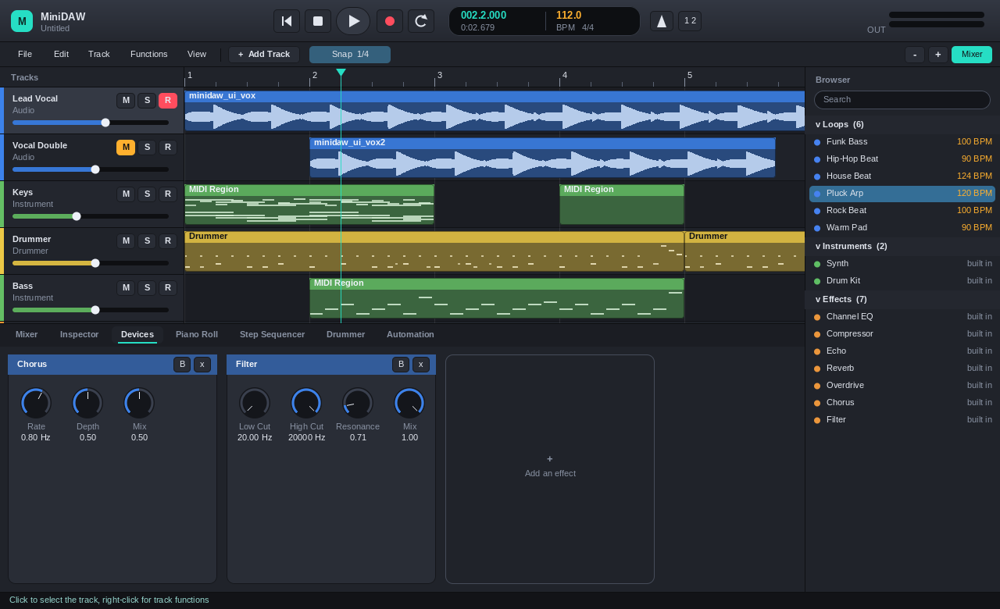

# 화면 구성

## 1. 컨트롤 바 (맨 위)
- 왼쪽: 프로그램 이름과 현재 프로젝트 파일 이름
- 가운데: **트랜스포트** - 처음으로, 정지, 재생/일시정지, 녹음, 사이클
- **LCD**: 마디.박.틱, 시간, 템포(BPM), 박자표. 왼쪽 숫자는 청록색, 템포는 주황색입니다.
- 메트로놈, 카운트인
- 오른쪽: 마스터 출력 레벨 미터

## 2. 툴바
- 메뉴: **File**, **Edit**, **Track**, **Functions**, **View**
- **+ Add Track**: 새 트랙
- **Snap**: 이동과 그리기의 격자(1 Bar, 1/2, 1/4, 1/8, 1/16, Off). 클릭할 때마다 바뀝니다.
- 오른쪽: 확대/축소, 아래 패널 표시 전환

## 3. 편곡 영역 (가운데)
- 맨 위 **눈금자**: 마디 번호. 클릭하면 재생 헤드가 그 위치로 갑니다. **Shift+드래그**하면 사이클 범위가 정해집니다.
  마커는 보라색 이름표로 보입니다.
- 왼쪽 **트랙 머리**: 색 띠, 이름, 종류, **M**(음소거) **S**(솔로) **R**(녹음 대기), 볼륨 슬라이더.
  트랙 높이는 View 메뉴에서 *Compact / Normal / Tall*로 바꿉니다. Tall에서는 팬도 보입니다.
- **리전**: 오디오는 파형, MIDI는 노트 미리보기로 그려집니다. 선택하면 흰 테두리가 생깁니다.

## 4. 아래 패널 (탭)
| 탭 | 하는 일 |
| --- | --- |
| Mixer | 모든 트랙의 채널 스트립 (이름, 인서트, 팬, 페이더, 레벨, M/S/R) |
| Inspector | 선택한 트랙과 리전의 속성 |
| Devices | 악기와 이펙트를 카드로 늘어놓고 노브로 조절 |
| Piano Roll | MIDI 노트 편집 |
| Step Sequencer | 드럼 머신 패턴 |
| Drummer | Drummer 리전의 스타일과 설정 |
| Automation | 볼륨, 팬, 센드, 프로젝트 템포의 변화 곡선 |

## 5. 브라우저 (오른쪽)
루프, 악기, 이펙트를 한 목록에 모아 둔 패널입니다. 위쪽 검색창에 글자를 치면 목록이 걸러집니다.
`L` 키로 숨기거나 보입니다. 자세한 내용은 [브라우저와 루프](browser-and-loops.md)를 보세요.

## 6. 상태 표시줄 (맨 아래)
마우스를 올린 버튼의 **사용법**이 청록색 글씨로 나오고, 그렇지 않을 때는 방금 한 일의 결과(예: "Saved ...")가 나옵니다.
오른쪽에는 현재 오디오 장치가 표시됩니다.
