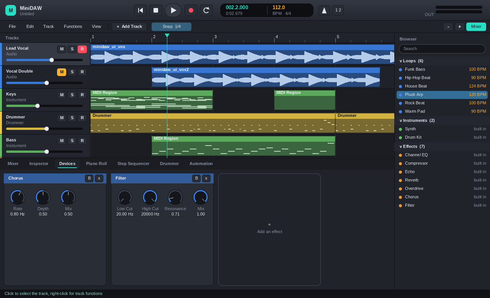

# The screen (Native version)

The Vulkan version has its own description in [The Vulkan interface](vulkan-interface.md).

## 1. Control bar (top)
- Left: program name and the current project file name
- Middle: **transport** - to start, stop, play/pause, record, cycle
- **LCD**: bar.beat.tick, time, tempo (BPM), time signature. The position is teal, the tempo orange.
- Metronome and count-in
- Right: master output level meter

## 2. Toolbar
- Menus: **File**, **Edit**, **Track**, **Functions**, **View**
- **+ Add Track**: a new track
- **Snap**: the grid for moving and drawing (1 Bar, 1/2, 1/4, 1/8, 1/16, Off). Click to cycle.
- Right: zoom and the bottom panel switch

## 3. Arrangement (middle)
- The **ruler** at the top shows bar numbers. Click it to move the playhead there. **Shift+drag** sets the cycle range. Markers appear as purple flags.
- **Track headers** on the left: colour strip, name, type, **M** (mute), **S** (solo), **R** (record arm) and a volume slider. Track height is *Compact / Normal / Tall* in the View menu; Tall also shows pan.
- **Regions**: audio shows its waveform, MIDI a note preview. A selected region has a white outline.

## 4. Bottom panel (tabs)
| Tab | What it does |
| --- | --- |
| Mixer | A channel strip for every track (name, inserts, pan, fader, level, M/S/R) |
| Inspector | Properties of the selected track and region |
| Devices | The instrument and effects as cards with knobs |
| Piano Roll | MIDI note editing |
| Step Sequencer | Drum machine patterns |
| Drummer | Style and settings of a Drummer region |
| Automation | Volume, pan, send and project tempo curves |

## 5. Browser (right)
One list for loops, instruments and effects. Type in the search box to filter. `L` hides or shows it. See [Browser and loops](browser-and-loops.md).

## 6. Status bar (bottom)
The **usage hint** of the control under the mouse is shown in teal; otherwise the result of the last action (for example "Saved ..."). The right side shows the current audio device.

## Also in the Native version
- **View > Aux A: Reverb... / Aux B: Echo...** edit the shared send effects.
- **File > Recover Autosaved Project** and **Open Recent > Clear Menu**.
- **Preferences** has *Play Test Tone*, *Choose Loops Folder...* and *Add VST3 Folder...*.
- New, Open and Recover ask first when the project has unsaved changes.
- **View > Browser: Preview on Click** switches the audition of loops on or off.
