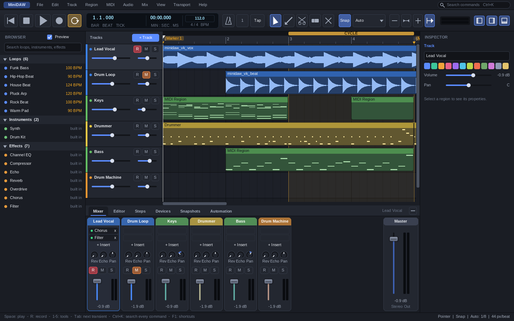
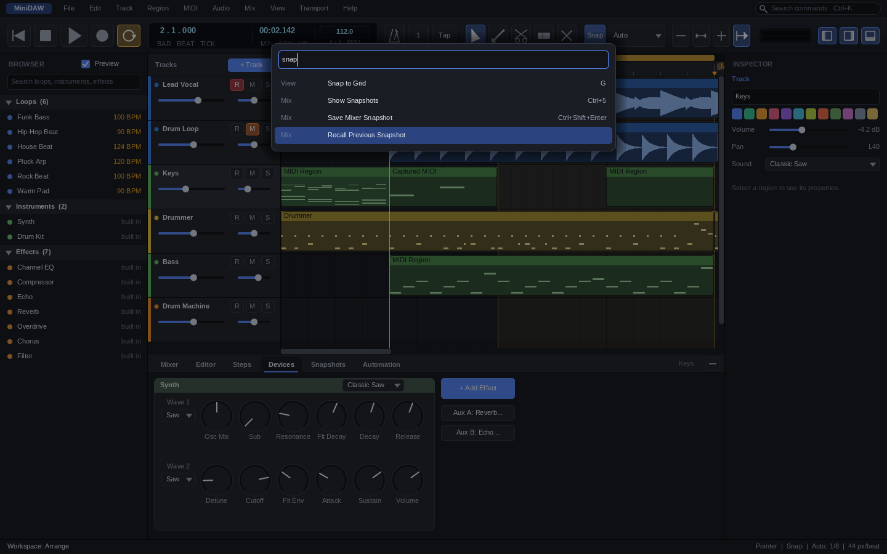
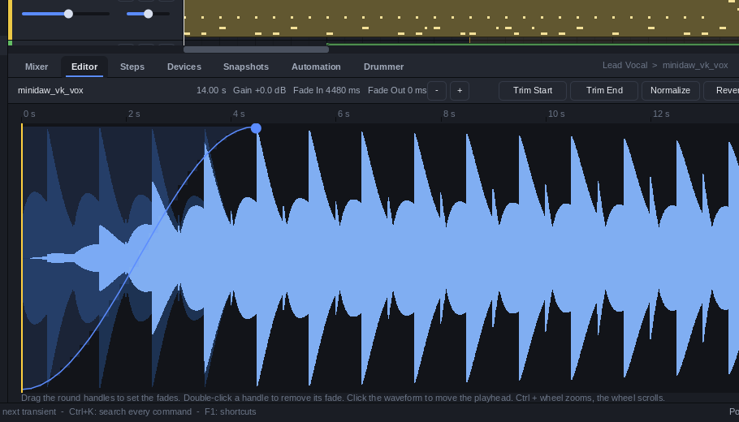
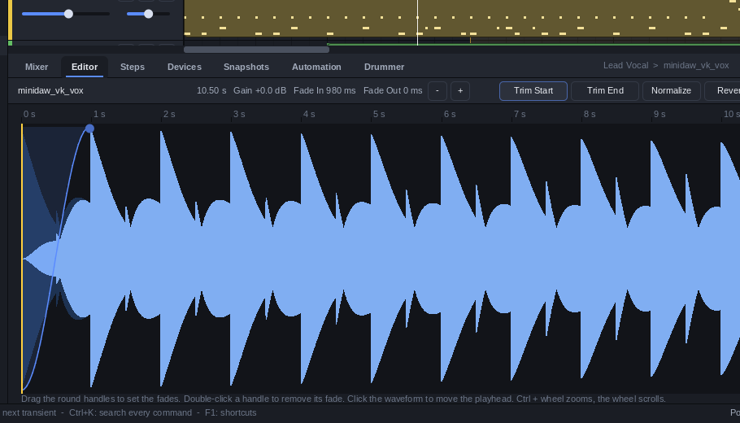
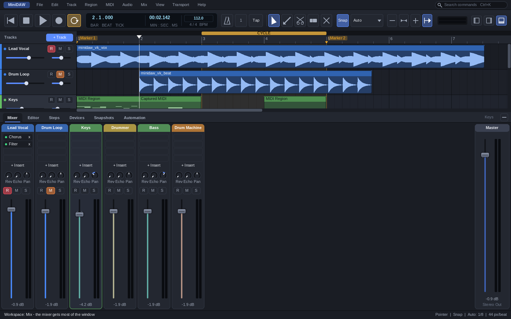

# The Vulkan interface (`MiniDAWVulkan.exe`)

A new interface, written from scratch and drawn by the graphics card through Vulkan. It uses the same engine, project files and sounds as the Native version; what differs is how you work.
It collects the best ideas of five DAWs - and only those.

## Layout
Menu bar - **transport bar** (play, record, cycle; LCD with bar.beat.tick, time, tempo, signature; metronome, count-in, tap tempo; tools; snap and grid; zoom; follow) -
**browser** (left) - **arrangement** (track headers, ruler with cycle strip and markers, lanes) - **inspector** (right) - **bottom panel** with the tabs *Mixer, Editor, Steps, Devices, Snapshots, Automation* - status bar.
Every divider can be dragged. The interface is drawn at your Windows display scale (and the *Interface scale* preference), so text stays sharp on every monitor.

## What it takes from which DAW
| From | Idea | In MiniDAW |
| --- | --- | --- |
| **Logic Pro** | One window with inspector, mixer and editors; the LCD; velocity-coloured notes and the region bar in the piano roll; screensets; Smart Help | Everything in one window, the LCD in the transport bar, velocity colours (`Colour` menu), **workspaces** `F5` Arrange / `F6` Mix / `F7` Edit, hints in the status bar. New functions: **Adapt Project Tempo to Region**, **Groove Template**. |
| **Ableton Live** | Browser with search and drag and drop; device chains with knobs; the **Auto** grid; **Fold** and Scale mode; Info View; Capture MIDI; Transform tools | Browser, Devices tab, Auto grid, Fold / Highlight / Lock, info line in the status bar, **Capture MIDI**, Stretch / Strum / Double Pattern, `Alt`+drag copies. |
| **FL Studio** | Chord stamps, Riff Machine, ghost notes, step sequencer you paint, colour-coded browser | **Stamp** menu, **Riff Machine**, **Ghost** notes, painted steps and painted velocities. |
| **Cubase** | Tool box (1-5), Logical Editor, MixConsole snapshots, workspaces, lower zone | **Tools** `1`-`5`, **Logical Editor**, **Snapshots** tab, workspaces, bottom panel. |
| **Pro Tools** | Edit tools, grid / slip, Tab to Transient, Beat Detective, Shuffle, nudge, zoom | **Snap** (grid / slip), **Tab to Transient**, **Beat Detective**, **Ripple Delete** (`Shift+Delete`), `Alt`+arrows nudge, zoom to fit. |

## Everything is a command: `Ctrl+K`
Press **`Ctrl+K`** (or click the search field in the menu bar), type a few letters - "riff", "quant", "snap", "ripple" - and press `Enter`. Every function of the program is there, with its shortcut.
**`F1`** shows the sheet of all shortcuts. The same command table feeds the menus, the shortcuts, the palette and the sheet, so they can never disagree.

## Tools (keys `1` - `5`)
| Key | Tool | What it does |
| --- | --- | --- |
| `1` | Pointer | Select, move, resize regions. `Alt`+drag duplicates. Double-click a MIDI region to edit it. |
| `2` | Pencil | Draw MIDI regions on instrument tracks; in the piano roll, write notes (`B` toggles draw mode there). |
| `3` | Scissors | Click a region to split it at the grid position. |
| `4` | Eraser | Click or drag over regions (arrangement) or notes (piano roll). |
| `5` | Mute | Click a region to mute or unmute it. |

## Snap and grid
**Snap** (`G`) turns the grid on or off; **Auto** follows the zoom level (the coarsest grid whose lines are at least 12 units apart), or choose Bar, 1/2, 1/4, 1/8, 1/16, 1/32, 1/8 triplet (`Shift+G` cycles).
Hold `Alt` while dragging to ignore the grid. The piano roll has its own grid menu.

## Zoom and scrolling
`Ctrl`+wheel zooms at the pointer, `Shift`+wheel or the sideways wheel scrolls in time, the wheel scrolls tracks, `Alt`+wheel changes the track height (or `H` cycles it). `Z` zooms to fit the project, `Shift+Z` to the selected region,
`F` makes the view follow the playhead.

## Mixer and snapshots
Mixer strips line up their faders. Click an insert to open it in **Devices**; right-click for Bypass / Remove. The **Snapshots** tab keeps named mixer states (Cubase MixConsole snapshots); `Alt+1` ... `Alt+9` recall them.

## Piano roll
See the [piano roll section of Editing](editing.md). Open it with a double-click on a MIDI region, or `E`.

## Audio editor
Select an audio region and open the **Editor** tab (`E`): the whole region is drawn as a waveform with a time ruler.

- **Two waveforms in one:** the dim one is the audio itself, the bright one is what you hear, with the region's gain and fades applied.
- **Fades:** the round handle at the top left sets the fade in, the one at the top right the fade out. Drag it (in whole milliseconds); **double-click** a handle to remove its fade. The curve is the one the engine plays, and the shaded part is the level the fade takes away. One drag is one undo step.
- **Playhead:** click in the waveform to move the playhead there.
- **Zoom:** the **+** / **-** buttons or `Ctrl`+wheel (around the pointer) zoom from 1x to 64x; when zoomed, the wheel scrolls. A handle moves the fade by what the mouse moves, so a zoomed view is a finer view. Choosing another region shows it whole again.
- **Trim Start** / **Trim End** cut the region at the playhead (also in the **Region** menu, and as `Ctrl+K` commands). The audio stays where it is; the region only gets shorter, and a fade that no longer fits is cut to the region. Undo brings the cut part back. Stretched or transposed audio cannot be trimmed this way.
- **Normalize** and **Reverse** are the same as in the Region menu; the gain itself is set in the inspector.

## Workspaces
`F5` **Arrange** (browser, inspector, mixer), `F6` **Mix** (the mixer fills the window), `F7` **Edit** (the editor fills the window). `X` shows or hides the bottom panel, `Shift+X` maximizes it, `B` and `I` toggle browser and inspector.

## If Vulkan does not start
The program tells you what is missing (no Vulkan driver, missing `shaders` folder, ...) and offers to start the Native version `MiniDAW.exe`. Update your graphics driver first.

## Selecting and moving several regions
- **Shift+click** or **Ctrl+click** a region adds it to the selection (or removes it again).
- **Drag on an empty part of a lane** draws a rubber band; every region it touches is selected. **Ctrl+A** selects every region.
- **Drag** any selected region to move the whole group. The group keeps its spacing and never moves before bar 1.
- **Drag over another track** to move the regions there. A region only changes track when it fits: audio on audio tracks, MIDI on instrument and Drummer tracks, Drummer regions on Drummer tracks. Others only move in time.
- **Alt+drag** duplicates the whole selection. **Delete**, **Ctrl+D**, **Ctrl+X / C / V** (the group keeps its spacing and its track layout), **Ctrl+Shift+M** (mute) and **Shift+Delete** (ripple delete) also work on the whole selection. Undo and redo clear the multi-selection.
- Every one of these is a single undo step.

## Tempo lane
Open the Automation tab and choose **Parameter > Tempo (BPM)**. Click to add a tempo change, drag a point to move it, **double-click** a point to make the tempo glide (ramp) to the next point, and right-click to delete it. The first point (bar 1) always stays. The curve is a staircase unless a point ramps. Every change can be undone.

## Drummer tab
Select a Drummer region and press `Ctrl+7` (or double-click the region). Choose a **Style**, then shape the groove with **Complexity**, **Loudness**, **Swing**, **Fills**, **Bars** and **Seed**; **Roll New Variation** picks a new seed. The pattern is shown on the right, one row per drum, and it plays as soon as you change something. Dragging a slider is one undo step.

## Tutorial
**Help > Tutorial...** (the first item of the Help menu) opens a 19-page tutorial that walks through the window, tracks, the browser, the Drummer, recording, the five tools, selecting several regions, the piano roll, the step sequencer, the mixer, automation, snapshots, workspaces, mixer groups, bringing files in, exporting for other DAWs, Preferences and handy extras, and saving. Use **Next** / **Back**, the Left / Right arrow keys or the dots at the bottom; **Try it** (on some pages) closes the tutorial and opens the matching panel; **Esc** closes it.

## Comfort and speed
- **Your layout is remembered.** Which panels are open, their sizes, the bottom tab, the track height, the zoom, Snap and Follow Playhead are saved in the settings file and restored the next time you start.
- **Notifications.** Messages (for example "Riff written" or "Snap off") appear as a small floating note above the status bar and fade out by themselves.
- **Middle mouse button.** Hold it over the lanes and drag to move the view like a hand.
- **Edge scrolling.** While you drag regions or a rubber band close to the edge of the lanes, the view scrolls by itself; the nearer to the edge (or beyond it), the faster.
- **Typing in Korean, Japanese or Chinese.** The text you are composing (for example a Hangul syllable that is not finished yet) appears inside the text field at the cursor, underlined, and becomes normal text when you confirm it. The IME's own windows open next to the cursor. While no text field has the focus, a keyboard in Hangul mode still sends plain keys, so shortcuts such as `Space`, `R`, `M` and `S` keep working without switching to English first.
- **Windows open at once.** Preferences and the tutorial no longer wait for anything: new characters (Korean, Japanese) are prepared a few at a time over the next frames, and the list of audio and MIDI devices is read in the background.
- **Light on the computer.** The window only redraws when something changes or moves. While the song plays, only the level meters are refreshed, so big projects stay smooth.

## Mixer groups
Tracks in the same group move together. Click the small circle at the right of a channel's header in the Mixer (or right-click a track header > **Mixer Group**) and pick **Group A** to **H**; **No Group** removes it. In a group:
- moving a **fader** keeps the ratio between the tracks (halve one, and the others are halved too),
- **pan** and the **sends** keep their difference,
- **mute** and **solo** are shared.

Hold **Alt** while changing a control to change only that track. Groups are saved with the project, and each group has its own colour and letter. You can also set a group from the command palette (`Ctrl+K`, "mixer group").

## Where the settings are
The Vulkan version keeps its settings in `vulkan-settings.ini`. The Preferences window shows the exact place: `%LOCALAPPDATA%\MiniDAW` for an installed copy, or the `data` folder next to the program in the portable edition (the one with `MiniDAW.portable`). The file is created at the first start and updated when you close the program.
